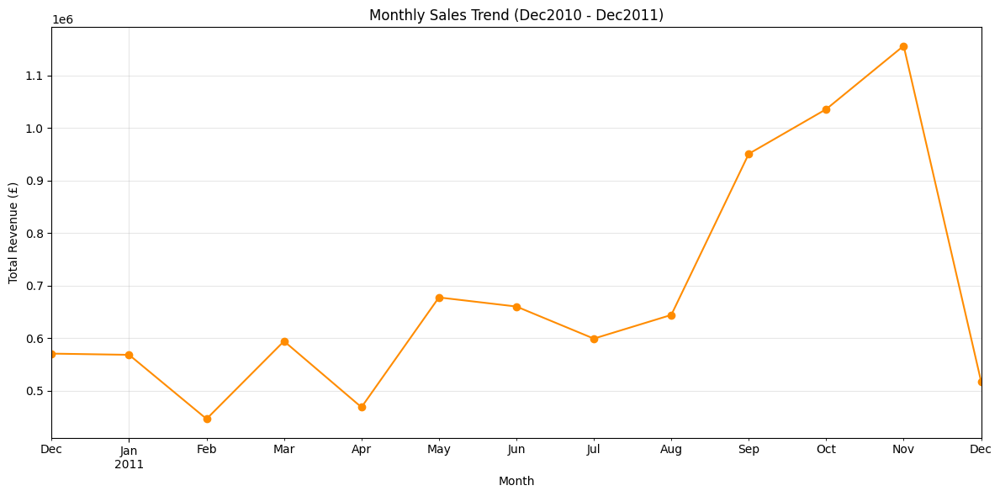
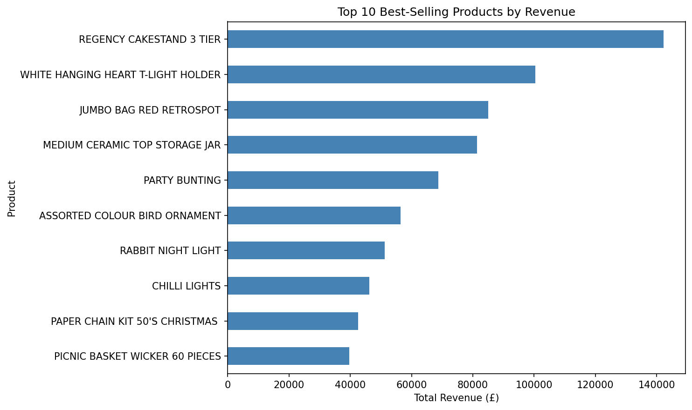
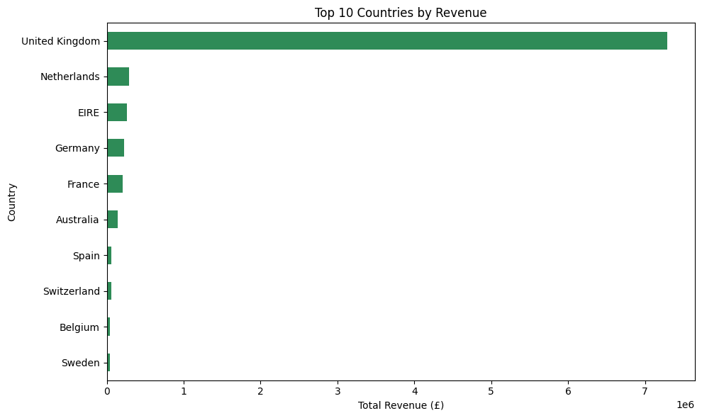

# Exploratory Data Analysis — E-commerce Dataset

End-to-end EDA on a UK-based online retailer's transaction data, performed in Python using Pandas and Matplotlib. Covers data cleaning, revenue analysis, seasonal trends, and market concentration.



## Objective

Perform end-to-end exploratory data analysis to identify sales trends, top-performing products, and revenue distribution across markets.

## Tools Used

- **Python**, **Pandas** (cleaning, transformation, aggregation), **Matplotlib** (visualisation)

## Dataset

- **Source:** E-Commerce Data (UK online retailer transactions), Kaggle
- **Size:** 541,909 transactions, Dec 2010 – 9 Dec 2011
- **Fields:** InvoiceNo, StockCode, Description, Quantity, InvoiceDate, UnitPrice, CustomerID, Country

## Data Cleaning

- Loaded with `ISO-8859-1` encoding to handle special characters (e.g., £)
- Removed cancelled orders (negative Quantity) and rows with missing CustomerID (~25% of the data)
- Removed duplicate rows
- Removed invoice 581483, an 80,995-unit order cancelled 12 minutes later. The initial analysis overcounted this cancelled bulk order; corrected.
- Created a `TotalPrice` column (`Quantity × UnitPrice`)
- **Result:** 541,909 → 392,731 valid transaction records

## Key Findings

1. **Data quality:** ~25% of rows had no CustomerID; 392,731 valid records remained after cleaning.
2. **Top products:** Regency Cakestand 3 Tier (£142,264.75), then White Hanging Heart T-Light Holder (£100,392.10). POSTAGE and Manual entries are excluded because they are not products.
3. **Seasonality:** Revenue peaked in November 2011 (£1.16M), consistent with pre-holiday demand. December is an incomplete month (data ends 9 Dec).
4. **Market concentration:** The UK generated 81.62% of revenue (£7.12M of £8.72M) across 37 countries.




## Recommendations

- Focus marketing spend around Sep–Nov to capture the pre-holiday surge
- Investigate low international revenue share; campaigns in the Netherlands and Germany could help diversify
- Prioritise inventory planning around top-selling products

## Repo Structure

```
ecommerce-eda/
├── README.md
├── ecommerce_eda.ipynb
└── charts/
    ├── top_products.png
    ├── monthly_sales_trend.png
    └── top_countries.png
```
